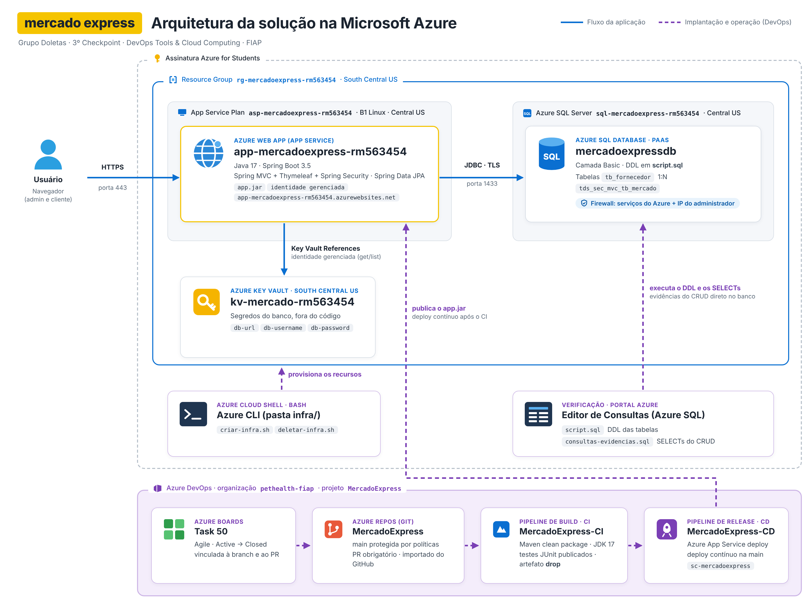

# 🍌 Mercado Express — Azure Pipelines CI/CD

**Grupo Doletas · 3º Checkpoint · 2º Semestre · DevOps Tools & Cloud Computing (FIAP · Prof. João Menk)**

Migração do App **Mercado Express** (Java 17 · Spring Boot 3 · Spring MVC + Thymeleaf + Spring Security)
para o **Azure DevOps**, com Pipeline de **Build (CI)** com testes JUnit e Pipeline de **Release (CD)**
entregando no **Azure App Service**, usando **Azure SQL Database (PaaS)** e **Azure Key Vault**.

| Integrante                 | RM     |
| -------------------------- | ------ |
| Artur Pioli Silva          | 565597 |
| Kevin Martins Campos       | 563454 |
| Matheus Arazin de Oliveira | 556649 |
| Pedro Gabriel Claes        | 566058 |

---

## Arquitetura



- **Fluxo da aplicação:** Usuário → HTTPS → Web App (Java 17) → JDBC/TLS → Azure SQL Database. As credenciais do banco são lidas do Azure Key Vault (Key Vault References + identidade gerenciada).
- **Implantação (DevOps):** Task no Boards → branch e Pull Request no Repos → Build (CI) com testes JUnit → Release (CD) publica o `app.jar` no Web App.
- **Infraestrutura:** criada pelo script `infra/criar-infra.sh` no Azure Cloud Shell. Resource Group e Key Vault em South Central US; SQL e App Service em Central US (regiões permitidas e com capacidade na assinatura Azure for Students).

## Banco de dados — tabelas com relacionamento

- `tb_fornecedor` **(1) ──── (N)** `tds_sec_mvc_tb_mercado` (produtos) — FK `fornecedor_id`
- `tds_users_mercado` (1) ──── (N) `tb_pedido` (1) ──── (N) `tb_item_pedido`

DDL completo: [`script.sql`](script.sql) · SELECTs de evidência: [`sql/consultas-evidencias.sql`](sql/consultas-evidencias.sql)

## CRUD na nuvem (perfil ADMIN)

| Tabela       | Create                                  | Read            | Update                      | Delete            |
| ------------ | --------------------------------------- | --------------- | --------------------------- | ----------------- |
| Fornecedores | `/fornecedores/novo`                    | `/fornecedores` | `/fornecedores/{id}/editar` | botão **Excluir** |
| Produtos     | `/produtos/novo` (escolhe o fornecedor) | `/produtos`     | `/produtos/{id}/editar`     | botão **Excluir** |

Usuários de teste: `admin@mercado.com / admin123` (ADMIN) · `cliente@mercado.com / cliente123` (CLIENTE)

## Infraestrutura (Azure CLI)

Scripts em [`infra/`](infra) — rodar no **Azure Cloud Shell (Bash)**:

```bash
cd infra
chmod +x criar-infra.sh deletar-infra.sh
./criar-infra.sh        # cria RG, Azure SQL, Key Vault, App Service Plan e Web App
./deletar-infra.sh      # remove tudo ao final
```

## Variáveis de ambiente e dados sensíveis

| Variável           | Onde fica               | Valor                                       |
| ------------------ | ----------------------- | ------------------------------------------- |
| `DB_URL`           | App Service → Key Vault | `@Microsoft.KeyVault(...db-url)`            |
| `DB_USERNAME`      | App Service → Key Vault | `@Microsoft.KeyVault(...db-username)`       |
| `DB_PASSWORD`      | App Service → Key Vault | `@Microsoft.KeyVault(...db-password)`       |
| `RABBIT_LISTENERS` | App Service             | `false` (mensageria não utilizada na nuvem) |
| `SERVER_PORT`      | App Service             | `80`                                        |

Nenhuma senha fica no repositório: a senha do banco é digitada na execução do script e gravada somente no
Key Vault. O Web App lê os segredos com **identidade gerenciada**.

## Pipelines

- **Build (CI)** — editor clássico, template Maven: `mercado-express/pom.xml` → `mvn package` (executa os testes
  JUnit e publica os resultados) → copia `app.jar` → publica o artefato `drop`. Trigger: CI na `main`.
- **Release (CD)** — template _Azure App Service deployment_, consome o artefato `drop` e publica o `app.jar`
  no Web App. Trigger: Continuous deployment ao terminar o Build.

## Testes unitários (JUnit 5 + Mockito)

`mercado-express/src/test/java` — `ProdutoTest`, `ProdutoServiceTest`, `FornecedorServiceTest`, `CarrinhoTest`.

```bash
cd mercado-express
mvn clean package      # compila, roda os testes e gera target/app.jar
```

## Execução local (opcional)

```bash
docker compose up -d                 # PostgreSQL + RabbitMQ locais
cd mercado-express && mvn spring-boot:run
# http://localhost:8080
```

> Documentação original do CP5 de Java (RabbitMQ, Banco Tranquilo, e-mail): [`docs/README-CP5-JAVA.md`](docs/README-CP5-JAVA.md)
